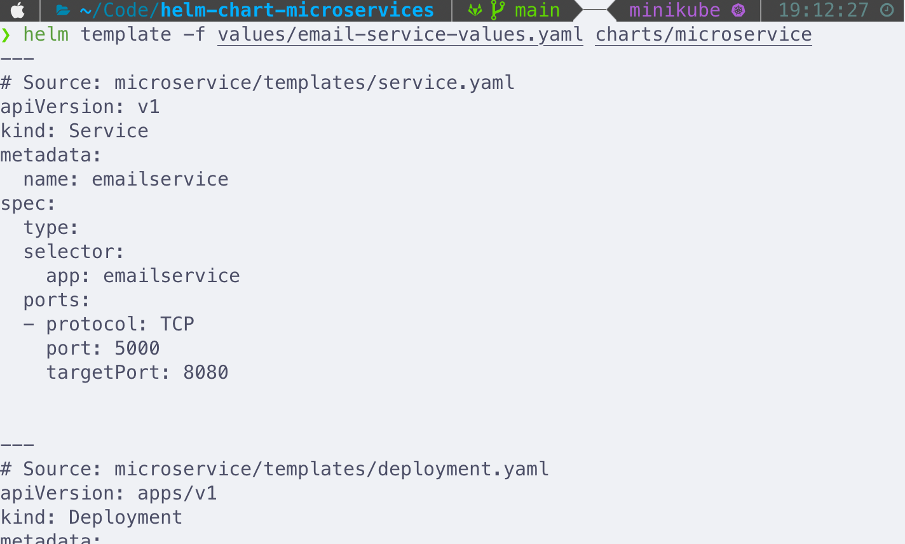
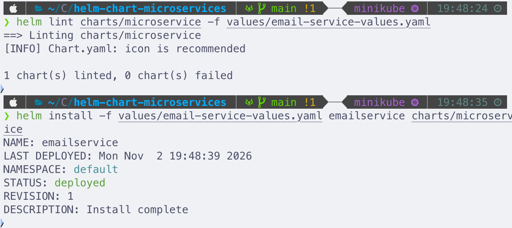
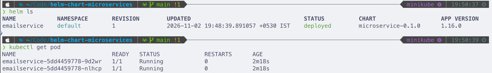
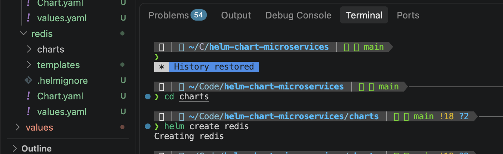
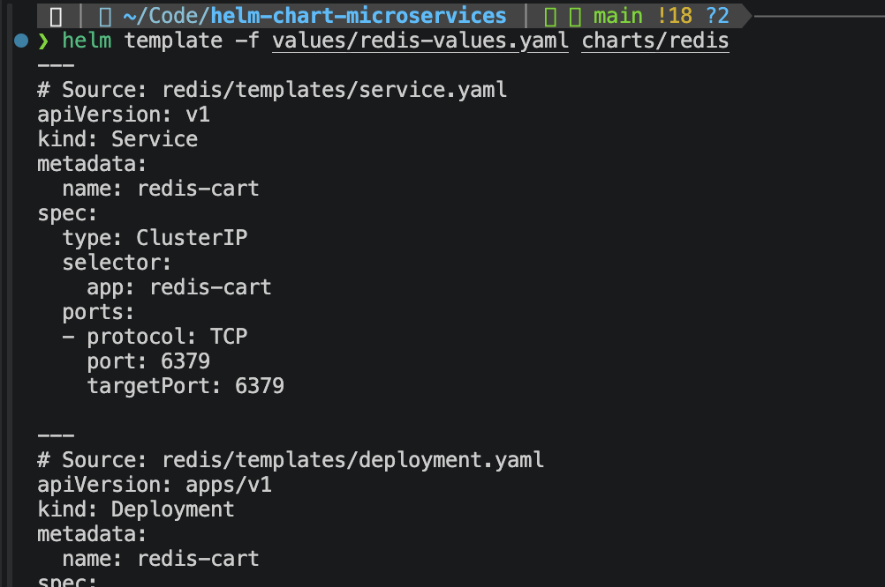

# Helm Chart for Microservices

## Description

This project uses a single shared Helm chart to deploy the microservices of the [Google microservices demo](https://github.com/GoogleCloudPlatform/microservices-demo), with a separate chart for Redis. The microservices have nearly identical Deployment and Service configuration. Rather than writing separate YAML for each one, this chart works as a single template. Each service only provides its own settings: name, image, port and environment variables. This keeps the configuration reusable and avoids repetition.

**Technologies:** Kubernetes, Helm, Minikube

**Related repo:** [k8s-microservices-production](https://gitlab.com/Tseyang/k8s-microservices-production.git) (the original Deployment and Service manifests)

## Prerequisites

- A running Kubernetes cluster (this project used Minikube)
- `kubectl` and `helm` installed

## Project structure

```
helm-chart-microservices/
├── charts/
│   ├── microservice/        # shared chart for the microservices
│   │   ├── Chart.yaml       # chart metadata
│   │   ├── values.yaml      # default values
│   │   ├── charts/          # chart dependencies (empty here)
│   │   ├── .helmignore      # files excluded from the package
│   │   └── templates/
│   │       ├── deployment.yaml
│   │       └── service.yaml
│   └── redis/               # separate chart for Redis
└── values/                  # one custom values file per service
    ├── email-service-values.yaml
    ├── redis-values.yaml
    └── ...
```

## How it works

Create the chart skeleton:

```bash
helm create microservice
```

This generates the following files:

| File / folder | Purpose |
|---|---|
| `Chart.yaml` | Chart metadata |
| `values.yaml` | Default values for the templates |
| `charts/` | Chart dependencies (empty here) |
| `.helmignore` | Files excluded from the packaged chart |
| `templates/` | The Kubernetes YAML blueprints |

The generated example templates are replaced with two templates of our own: `deployment.yaml` and `service.yaml`.

Each template looks like normal Kubernetes YAML, but hard-coded values are replaced with placeholders in the form `{{ .Values.varName }}`. When you install, Helm's template engine fills in the placeholders from the values files and sends the rendered YAML to Kubernetes.

Conventions:

- Variable names are camelCase.
- The values hierarchy is kept flat, as Helm recommends.

### `templates/deployment.yaml`

```yaml
apiVersion: apps/v1
kind: Deployment
metadata:
  name: {{ .Values.appName }}
spec:
  replicas: {{ .Values.appReplicas }}
  selector:
    matchLabels:
      app: {{ .Values.appName }}
  template:
    metadata:
      labels:
        app: {{ .Values.appName }}
    spec:
      containers:
        - name: {{ .Values.appName }}
          image: "{{ .Values.appImage }}:{{ .Values.appVersion }}"
          ports:
            - containerPort: {{ .Values.containerPort }}
          env:
            {{- range .Values.containerEnvVars }}
            - name: {{ .name }}
              value: {{ .value | quote }}
            {{- end }}
```

Environment variables are dynamic. `range` loops over the `containerEnvVars` list, and each item's `name` and `value` are rendered. Env var values must be strings, so `| quote` pipes the value through the `quote` function.

> **Note:** the `range` block reads `.name`, not `.key`. The field names in the template must match the keys in the values file, otherwise Kubernetes rejects the Deployment with `env[0].name: Required value`.

### `templates/service.yaml`

```yaml
apiVersion: v1
kind: Service
metadata:
  name: {{ .Values.appName }}
spec:
  type: {{ .Values.serviceType }}
  selector:
    app: {{ .Values.appName }}
  ports:
    - protocol: TCP
      port: {{ .Values.servicePort }}
      targetPort: {{ .Values.containerPort }}
```

### Default `values.yaml`

```yaml
appName: service-name
appImage: us-central1-docker.pkg.dev/google-samples/microservices-demo/service-name
appVersion: v0.10.5
appReplicas: 2
containerPort: 3550
containerEnvVars:
  - name: ENV_VAR
    value: "value1"

serviceType: ClusterIP
servicePort: 3550
```

## Custom values per service

Rather than editing the defaults, each service gets its own values file in the `values/` directory, outside the chart. Example, `values/email-service-values.yaml`:

```yaml
appName: emailservice
appImage: us-central1-docker.pkg.dev/google-samples/microservices-demo/emailservice
appVersion: v0.10.5
appReplicas: 2
containerPort: 8080
containerEnvVars:
  - name: PORT
    value: "8080"

servicePort: 5000
```

## Validate before installing

Preview the rendered YAML without touching the cluster:

```bash
helm template emailservice charts/microservice -f values/email-service-values.yaml
```

Check for problems that would break conventions or fail installation:

```bash
helm lint charts/microservice -f values/email-service-values.yaml
```



## Deploy a service

```bash
helm install -f <values-file> <release-name> <chart>
```

Example:

```bash
helm install -f values/email-service-values.yaml emailservice charts/microservice
```



Verify:

```bash
helm ls          # emailservice is listed as a release of the microservice chart
kubectl get pod  # two emailservice replicas are running
```



## Deploy all other microservices

Each microservice is installed as a separate release using the same chart and its own values file:

```bash
helm install -f values/<service>-values.yaml <service> charts/microservice
```

## Redis chart

Redis is a third-party service used by `cartservice`. It has a different lifecycle than the microservices, so it lives in its own chart.

1. Move the `microservice` chart into a parent `charts/` folder.
2. From inside `charts/`, run `helm create redis`.
3. Replace the generated templates with a Deployment and a Service that use placeholders.
4. Add a `values/redis-values.yaml` file with the Redis-specific values.



Validate and preview:

```bash
helm template -f values/redis-values.yaml charts/redis
helm install --dry-run -f values/redis-values.yaml redis charts/redis
```



Install:

```bash
helm install -f values/redis-values.yaml redis charts/redis
```


## Cleanup

```bash
helm uninstall <release-name>
helm ls --all-namespaces   # confirm nothing is left
```